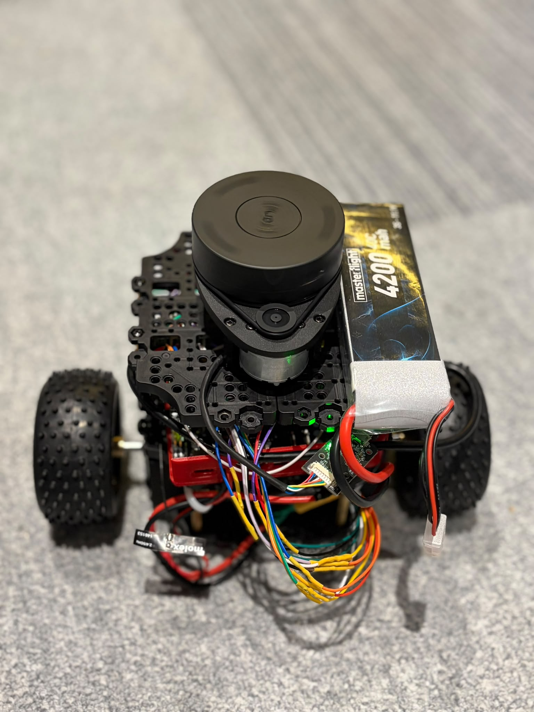
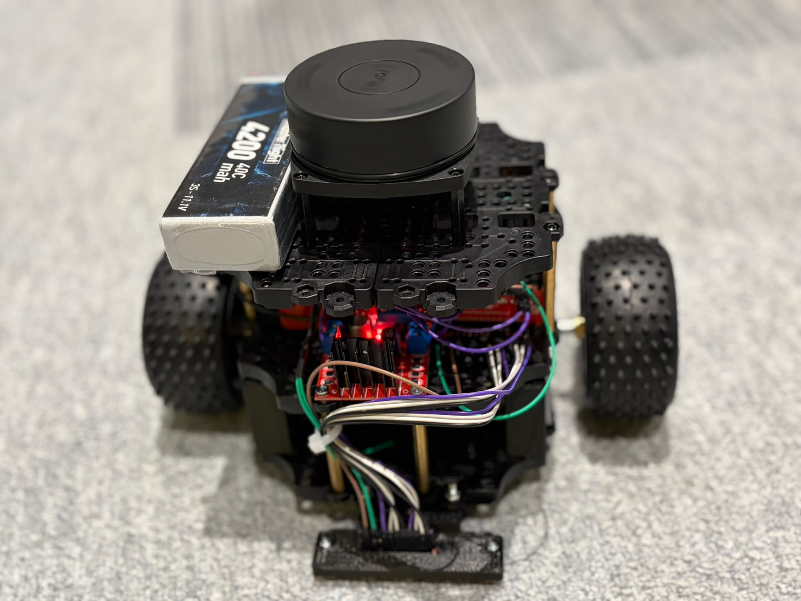

<p align="center">
    <picture>
        <source media="(prefers-color-scheme: dark)" srcset=".meta/logo-dark.png" width="40%" />
        <source media="(prefers-color-scheme: light)" srcset=".meta/logo-light.png" width="40%" />
        
    </picture>
</p>

# T3 Gemstone UGV ROS

**English** · [Türkçe](README_tr.md)

 [](https://www.t3vakfi.org/en) [](https://docs.t3gemstone.org/en/projects/ugv-ros/overview) [](https://opensource.org/licenses/Apache-2.0) [](https://docs.t3gemstone.org/en/boards/o1) [](https://www.ti.com/product/AM67A) [](https://docs.ros.org/en/jazzy/) [](https://releases.ubuntu.com/24.04/) [](https://taskfile.dev) [](https://github.com/89luca89/distrobox) [](https://www.jetify.com/devbox/docs/contributor-quickstart/)

<p align="center">
  <a href=".meta/ugv-rear.png"></a>
  <a href=".meta/ugv-front.png"></a>
</p>

UGV ROS is a differential-drive ground robot built on the T3 Gemstone O1, running **Ubuntu 24.04 and ROS 2 Jazzy**. It drives manually from a browser, keyboard or gamepad, follows a line with an eight-channel analog sensor read through a Deneyap Mini v2, and maps its surroundings with an RPLIDAR A1; with Nav2 enabled it drives to goals on a saved map.

## Documentation

The guides are on the [T3 Gemstone documentation site](https://docs.t3gemstone.org/en/projects/ugv-ros/overview):

| Guide | Contents |
| --- | --- |
| [Installation](https://docs.t3gemstone.org/en/projects/ugv-ros/installation) | Ubuntu, ROS 2 and the UGV software, Deneyap firmware, PWM and UART overlays |
| [Hardware and Wiring](https://docs.t3gemstone.org/en/projects/ugv-ros/hardware) | Components, pin map, wiring diagrams |
| [Battery and Operating Safety](https://docs.t3gemstone.org/en/projects/ugv-ros/safety) | Li-Po battery rules, transport and safe operation |
| [Field Test](https://docs.t3gemstone.org/en/projects/ugv-ros/field-test) | IMU, motor, encoder, lidar and line sensor checks |
| [Usage](https://docs.t3gemstone.org/en/projects/ugv-ros/usage) | Launch arguments, web UI, calibration, mapping, systemd service, updates, Docker |
| [Simulation](https://docs.t3gemstone.org/en/projects/ugv-ros/simulation) | Mapping, navigation and line following in Gazebo, without the robot |
| [Network Connection](https://docs.t3gemstone.org/en/projects/ugv-ros/network) | Connecting the robot to Wi-Fi and finding its IP address |
| [Architecture](https://docs.t3gemstone.org/en/projects/ugv-ros/architecture) | ROS 2 packages, data flow, drive modes, TF tree, topics and services |

## Quick start

On a T3 Gemstone O1 running Ubuntu 24.04, install the software, then start the robot and open `http://<robot-ip>:8000` from a computer on the same network:

```bash
gemstone@t3-gem-o1:$ git clone https://github.com/t3gemstone/ugv-ros.git ~/ugv-ros
gemstone@t3-gem-o1:$ cd ~/ugv-ros && bash scripts/install-native.sh
gemstone@t3-gem-o1:$ sudo bash scripts/start-native.sh
```

`sudo bash scripts/install-service.sh 1` starts the robot at every boot; `1` is its `ROS_DOMAIN_ID`. Before the first drive, follow the [installation](https://docs.t3gemstone.org/en/projects/ugv-ros/installation) and [field test](https://docs.t3gemstone.org/en/projects/ugv-ros/field-test) guides for the Deneyap firmware, the overlays and the hardware checks.

## Development environment

Building, testing and hardware-free trials need no ROS 2 on your computer: a development environment with Ubuntu 24.04 and ROS 2 Jazzy is built from the `box` stage of the `Dockerfile` and opened with Distrobox. The repository appears inside it as `/home/workdir`.

```bash
user@host:$ ./setup.sh                       # installs Docker and jetify-devbox
user@host:$ devbox shell                     # installs Distrobox, Task and vcstool
📦 devbox:ugv-ros> task fetch                # third-party sources (repos.yml)
📦 devbox:ugv-ros> task box                  # create and enter the environment
🚀 distrobox:workdir> task                   # list all tasks
🚀 distrobox:workdir> task build             # colcon build; extra arguments go to colcon
🚀 distrobox:workdir> task lint              # flake8 and shellcheck
🚀 distrobox:workdir> task test              # unit and web UI tests (same as CI)
🚀 distrobox:workdir> task mock              # robot without hardware, UI at http://localhost:8000
🚀 distrobox:workdir> task sim               # robot in a Gazebo office world, UI at http://localhost:8000
```

`task sim` runs the robot in Gazebo Harmonic with its lidar, IMU and line sensor, so mapping, navigation and line following can be tried without the robot; it starts on a line track, so **Line follow** works right away (`task sim -- nav:=true` adds Nav2, `gui:=false` runs it without the Gazebo window). `task destroy` removes the environment. If `task box` fails, run `distrobox-enter --additional-flags "--tty" --name gemstone-ugv-ros --no-workdir --verbose` to see why; an `update-locale: Error: invalid locale settings` message is fixed with `sudo dpkg-reconfigure locales` on the host.

## Repository layout

```
.meta/                 README images
.distrobox/            shell settings of the development environment (task box)
.github/workflows/     CI: lint, build and tests in the development environment
boards/t3-gem-o1/      device tree overlay for the T3 Gemstone O1
firmware/deneyap_line/ Deneyap Mini v2 line sensor firmware
scripts/               install, start and systemd service scripts for the robot
sim/ugv_simulation/    Gazebo Harmonic simulation (development computer only)
src/                   ROS 2 packages (ugv_*)
Dockerfile             base, box (development environment) and robot (runtime image) stages
Taskfile.yml           development environment, build, test and hardware-free trial tasks
compose.yaml           running the robot with Docker
devbox.json            host tools: Distrobox, Task, vcstool
distrobox.ini          Distrobox settings for task box
repos.yml              third-party packages built from source (sllidar_ros2)
setup.sh               installs Docker and jetify-devbox on the host
```
