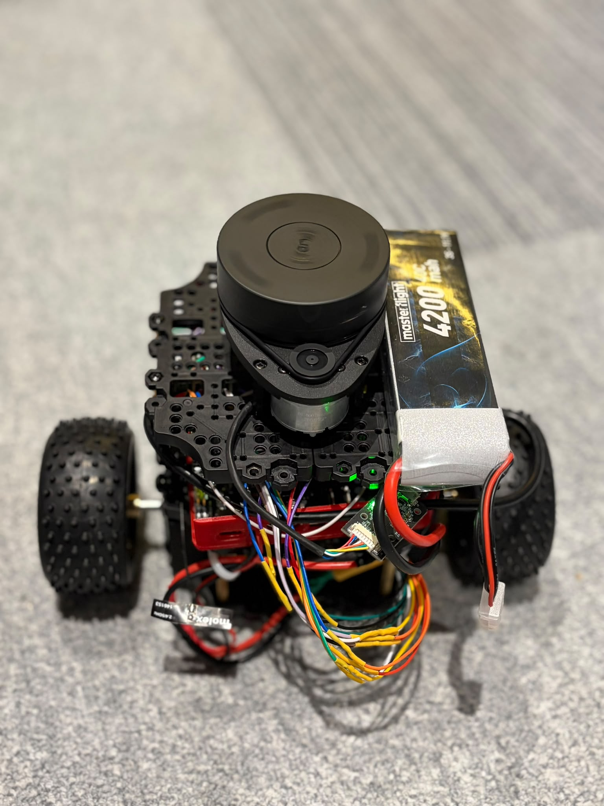
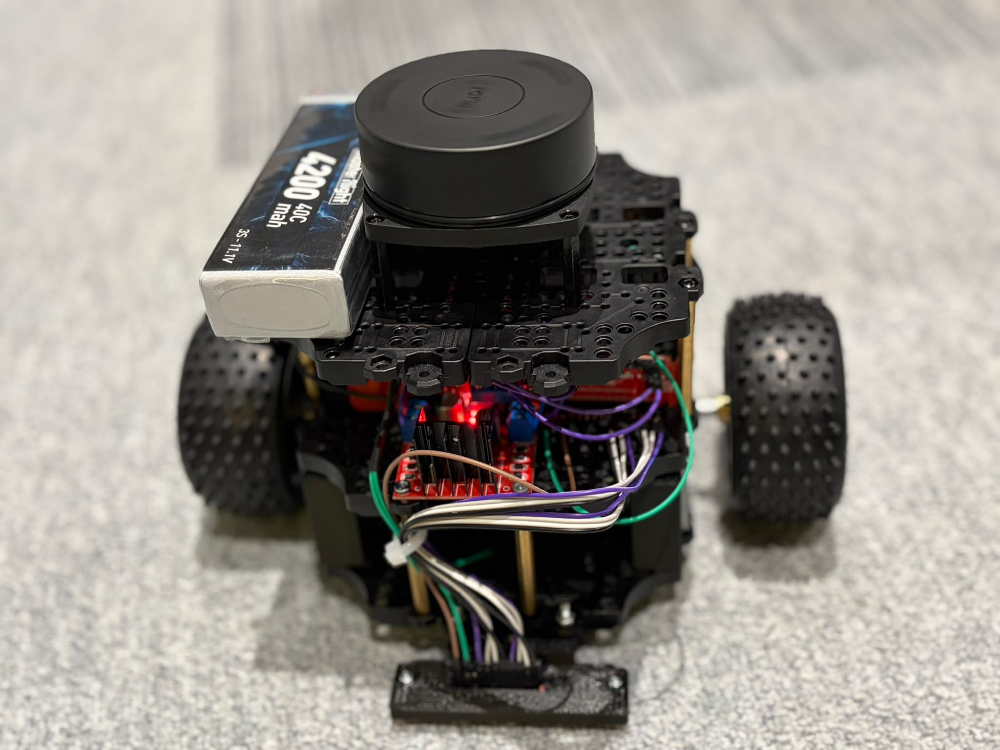

<p align="center">
    <picture>
        <source media="(prefers-color-scheme: dark)" srcset=".meta/logo-dark.png" width="40%" />
        <source media="(prefers-color-scheme: light)" srcset=".meta/logo-light.png" width="40%" />
        
    </picture>
</p>

# T3 Gemstone UGV ROS

[English](README.md) · **Türkçe**

 [](https://www.t3vakfi.org/tr) [](https://docs.t3gemstone.org/tr/projects/ugv-ros/overview) [](https://opensource.org/licenses/Apache-2.0) [](https://docs.t3gemstone.org/tr/boards/o1) [](https://www.ti.com/product/AM67A) [](https://docs.ros.org/en/jazzy/) [](https://releases.ubuntu.com/24.04/) [](https://taskfile.dev) [](https://github.com/89luca89/distrobox) [](https://www.jetify.com/devbox/docs/contributor-quickstart/)

<p align="center">
  <a href=".meta/ugv-rear.png"></a>
  <a href=".meta/ugv-front.png"></a>
</p>

UGV ROS, T3 Gemstone O1 tabanlı, diferansiyel sürüşlü bir kara robotudur ve **Ubuntu 24.04 ile ROS 2 Jazzy** üzerinde çalışır. Tarayıcıdan, klavyeden ya da gamepad ile elle sürülür; Deneyap Mini v2 üzerinden okunan sekiz kanallı analog sensörle çizgi izler ve RPLIDAR A1 ile çevresinin haritasını çıkarır. Nav2 etkinleştirildiğinde kayıtlı harita üzerinde verilen hedefe gider.

## Belgeler

Kılavuzlar [T3 Gemstone dokümantasyon sitesindedir](https://docs.t3gemstone.org/tr/projects/ugv-ros/overview):

| Kılavuz | İçerik |
| --- | --- |
| [Kurulum](https://docs.t3gemstone.org/tr/projects/ugv-ros/installation) | Ubuntu, ROS 2 ve UGV yazılımı, Deneyap yazılımı, PWM ve UART overlay'leri |
| [Donanım ve Kablolama](https://docs.t3gemstone.org/tr/projects/ugv-ros/hardware) | Bileşenler, pin haritası, kablolama şemaları |
| [Pil ve Kullanım Güvenliği](https://docs.t3gemstone.org/tr/projects/ugv-ros/safety) | Li-Po pil kuralları, taşıma ve güvenli kullanım |
| [Saha Testi](https://docs.t3gemstone.org/tr/projects/ugv-ros/field-test) | IMU, motor, enkoder, lidar ve çizgi sensörü kontrolleri |
| [Kullanım](https://docs.t3gemstone.org/tr/projects/ugv-ros/usage) | Başlatma argümanları, web arayüzü, kalibrasyon, haritalama, systemd servisi, güncelleme, Docker |
| [Ağ Bağlantısı](https://docs.t3gemstone.org/tr/projects/ugv-ros/network) | Robotu Wi-Fi ağına bağlama ve IP adresini bulma |
| [Mimari](https://docs.t3gemstone.org/tr/projects/ugv-ros/architecture) | ROS 2 paketleri, veri akışı, sürüş modları, TF ağacı, topic ve servisler |

## Hızlı başlangıç

Ubuntu 24.04 kurulu T3 Gemstone O1'de yazılımı kurun, ardından robotu başlatıp aynı ağdaki bir bilgisayardan `http://<robot-ip>:8000` adresini açın:

```bash
gemstone@t3-gem-o1:$ git clone https://github.com/t3gemstone/ugv-ros.git ~/ugv-ros
gemstone@t3-gem-o1:$ cd ~/ugv-ros && bash scripts/install-native.sh
gemstone@t3-gem-o1:$ sudo bash scripts/start-native.sh
```

`sudo bash scripts/install-service.sh 1` robotu her açılışta başlatır; `1` robotun `ROS_DOMAIN_ID` değeridir. İlk sürüşten önce Deneyap yazılımı, overlay'ler ve donanım kontrolleri için [kurulum](https://docs.t3gemstone.org/tr/projects/ugv-ros/installation) ve [saha testi](https://docs.t3gemstone.org/tr/projects/ugv-ros/field-test) kılavuzlarını izleyin.

## Geliştirme ortamı

Derleme, test ve donanımsız deneme için bilgisayarınızda ROS 2 gerekmez: Ubuntu 24.04 ve ROS 2 Jazzy içeren geliştirme ortamı `Dockerfile`'ın `box` aşamasından oluşturulur ve Distrobox ile açılır. Depo ortamın içinde `/home/workdir` olarak görünür.

```bash
user@host:$ ./setup.sh                       # Docker ve jetify-devbox'ı kurar
user@host:$ devbox shell                     # Distrobox, Task ve vcstool'u kurar
📦 devbox:ugv-ros> task fetch                # üçüncü parti kaynaklar (repos.yml)
📦 devbox:ugv-ros> task box                  # ortamı oluşturur ve içine girer
🚀 distrobox:workdir> task                   # tüm görevleri listeler
🚀 distrobox:workdir> task build             # colcon ile derler; ek argümanlar colcon'a geçer
🚀 distrobox:workdir> task lint              # flake8 ve shellcheck
🚀 distrobox:workdir> task test              # birim ve web arayüzü testleri (CI ile aynı)
🚀 distrobox:workdir> task mock              # donanımsız robot, arayüz http://localhost:8000
🚀 distrobox:workdir> task sim               # Gazebo ofis dünyasında robot, arayüz http://localhost:8000
```

`task sim` robotu lidarı, IMU'su ve çizgi sensörüyle Gazebo Harmonic'te çalıştırır; haritalama, navigasyon ve çizgi izleme robot olmadan denenebilir. Robot bir çizgi pistinin üzerinde başlar, **Line follow** hemen denenebilir (`task sim -- nav:=true` Nav2'yi ekler, `gui:=false` Gazebo penceresi olmadan çalıştırır). `task destroy` ortamı siler. `task box` başarısız olursa nedenini görmek için `distrobox-enter --additional-flags "--tty" --name gemstone-ugv-ros --no-workdir --verbose` komutunu çalıştırın; `update-locale: Error: invalid locale settings` hatası host'ta `sudo dpkg-reconfigure locales` ile giderilir.

## Depo yapısı

```
.meta/                 README görselleri
.distrobox/            geliştirme ortamının kabuk ayarları (task box)
.github/workflows/     CI: geliştirme ortamında lint, derleme ve testler
boards/t3-gem-o1/      T3 Gemstone O1 için device tree overlay
firmware/deneyap_line/ Deneyap Mini v2 çizgi sensörü yazılımı
scripts/               robota kurulum, başlatma ve systemd servisi betikleri
sim/ugv_simulation/    Gazebo Harmonic simülasyonu (yalnızca geliştirme bilgisayarında)
src/                   ROS 2 paketleri (ugv_*)
Dockerfile             base, box (geliştirme ortamı) ve robot (çalışma imajı) aşamaları
Taskfile.yml           geliştirme ortamı, derleme, test ve donanımsız deneme görevleri
compose.yaml           robotu Docker ile çalıştırma
devbox.json            host araçları: Distrobox, Task, vcstool
distrobox.ini          task box'ın Distrobox ayarları
repos.yml              kaynaktan derlenen üçüncü parti paketler (sllidar_ros2)
setup.sh               host'a Docker ve jetify-devbox kurulumu
```
